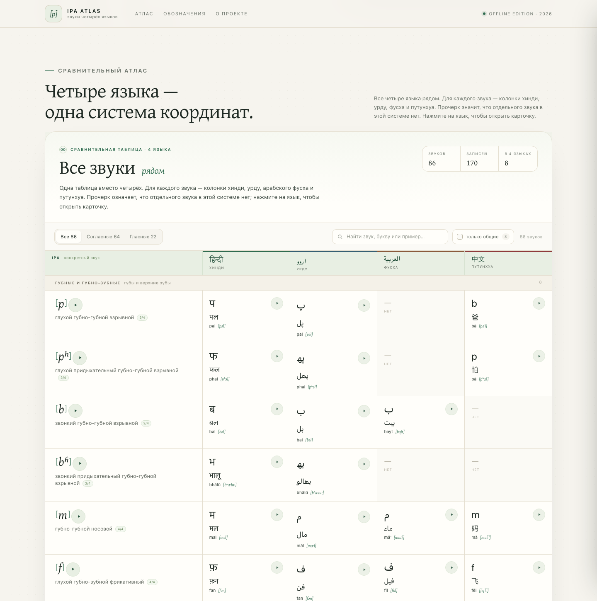

# IPA Atlas — звуки четырёх языков

**Живая версия:** https://dradns.github.io/ipa-script-atlas/

[](https://dradns.github.io/ipa-script-atlas/)

Автономный фонетический атлас: хинди (деванагари), урду (насталик),
арабский фусха и путунхуа. В одной таблице, без переключения языков:
у каждого конкретного звука сразу четыре колонки — письмо и пример
для каждого языка.

## Как открыть

Откройте `index.html` в браузере или lives-версию на GitHub Pages:
https://dradns.github.io/ipa-script-atlas/

Сайт полностью автономный: шрифты, стили, данные и аудио лежат рядом,
внешних запросов нет. Версия на Pages — тот же набор файлов из ветки `main`.

## Что внутри

```
index.html          разметка и тексты
styles.css          оформление
app.js              сравнение, поиск, карточка звука, аудио
assets/data.js      данные 170 записей и 86 сравнительных строк (генерируется)
assets/audio/       mp3-примеры (170 файлов)
assets/fonts/       Gentium Plus (SIL OFL) + лицензия
src/atlas_data.py   исходные данные
src/build.py        сборка data.js и аудио
```

## Главное

- Все четыре языка видны одновременно. Переключателей языков нет.
- Колонка `IPA` показывает конкретный звук в квадратных скобках, например
  `[p]`, `[pʰ]`, `[bʱ]`, `[t̪]`, `[ʈ]`, и его артикуляцию по-русски.
- В строке звука — четыре колонки: хинди, урду, фусха, путунхуа. В каждой
  буква, пример и транскрипция. Прочерк `—` значит, что отдельного звука
  в этой системе нет.
- Кнопка `▶` у IPA проигрывает звук во всех доступных языках подряд;
  в ячейке языка на десктопе есть своя мини-кнопка. Нажатие на язык
  открывает карточку с фонемой `/p/`, артикуляцией и родственными звуками.
- Фильтры: «Все / Согласные / Гласные», «только общие» (звуки, которые
  есть во всех четырёх языках) и поиск по буквам, примерам и описаниям.

Всего 86 уникальных звуков и 170 языковых записей; 8 звуков встречаются
во всех четырёх языках.

## Сборка

```bash
python3 src/build.py            # только data.js
python3 src/build.py --audio    # data.js + скачать/обновить mp3
```

Аудио примеров синтезировано через Google Translate TTS и сохранено
локально. Это учебные примеры слов, а не изолированные шумы: звук слышен
в естественном окружении. Если файл не найден, браузер попробует
локальный `speechSynthesis`.

## Оговорки

- Показаны литературные нормы; диалектные и позиционные варианты
  отмечены в карточках, но не образуют отдельные строки.
- Тоны путунхуа записаны тоновыми буквами `˥ ˧ ˩`; в сегментную
  транскрипцию они не входят.
- Описания артикуляции учебные и не заменяют учебник или консультацию
  преподавателя.

## Лицензия шрифта

Gentium Plus © SIL International, SIL Open Font License 1.1.
Полный текст — `assets/fonts/OFL.txt`. Файлы шрифтов не изменялись.
